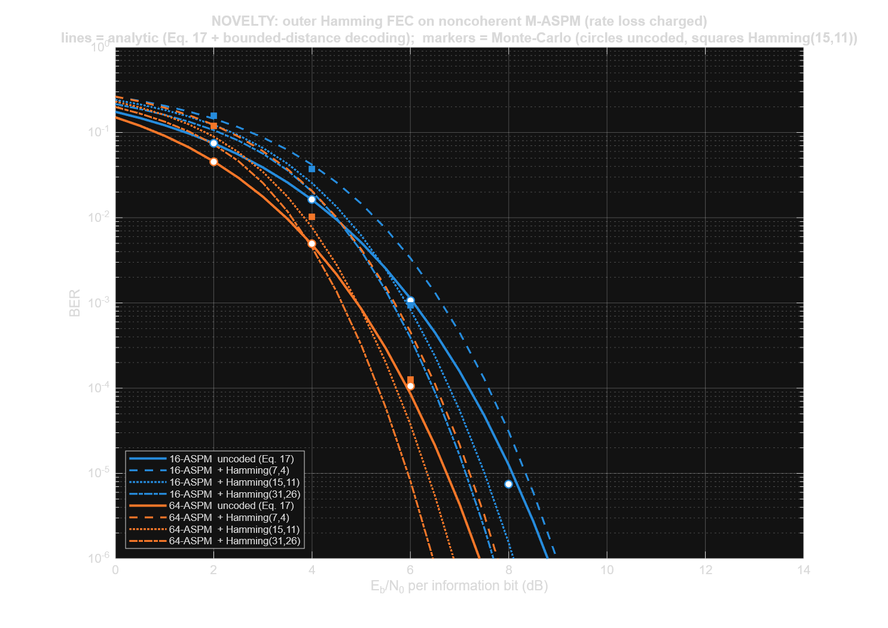
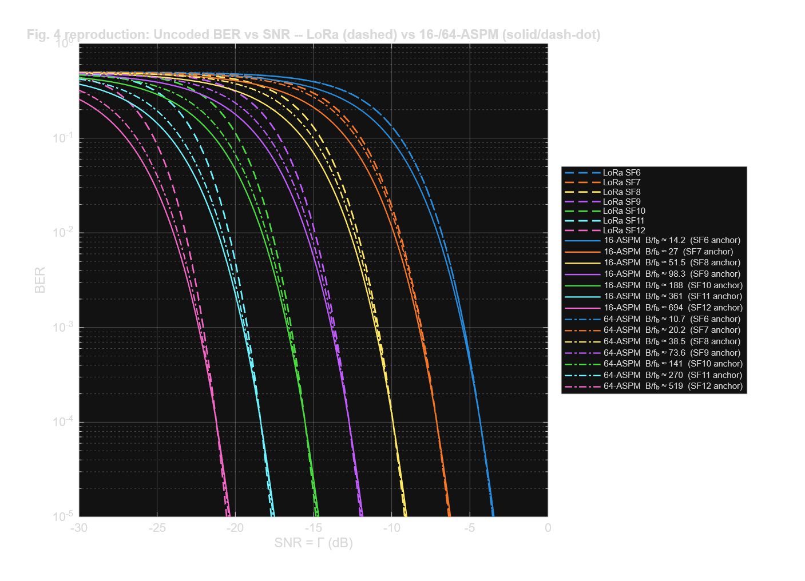
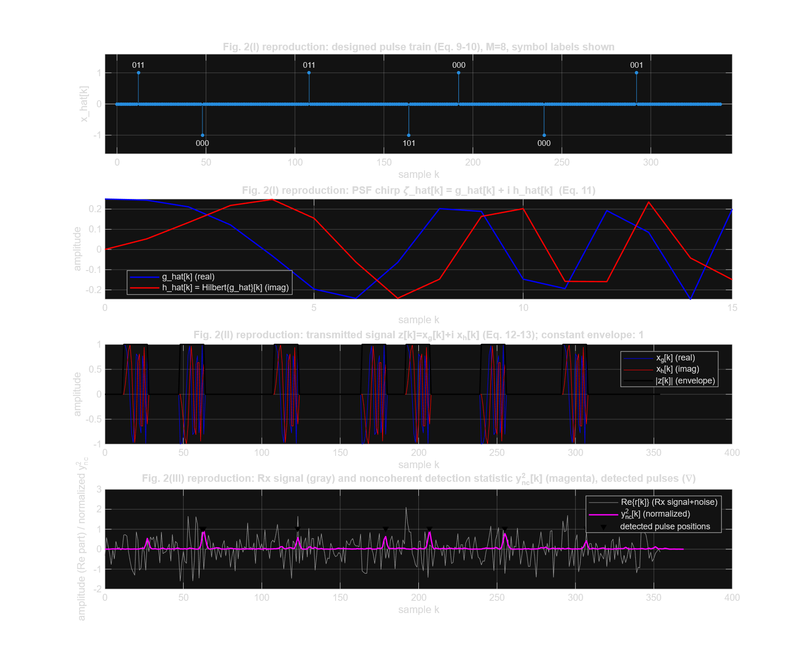
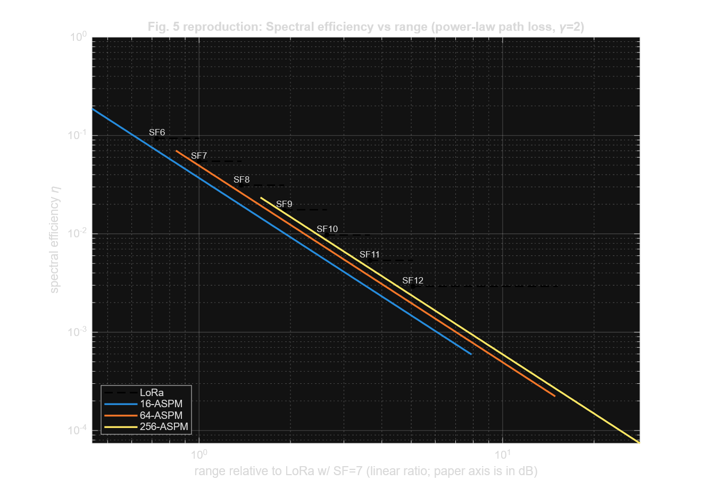
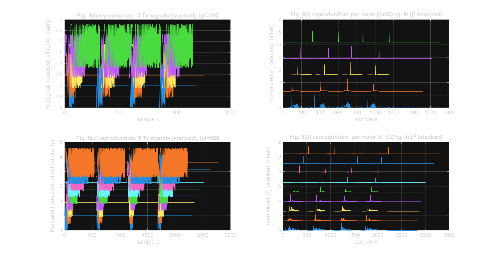

# M-ASPM + Hamming FEC — LPWAN Modulation in MATLAB

MATLAB reproduction of **M-ary Aggregate Spread Pulse Modulation (M-ASPM)** for highly scalable
LPWANs (Nikitin & Davidchack, IEEE Access 2023), extended with an **outer Hamming forward-error-
correction layer** (our novelty) — codec, interleaver, closed-form coded-BER analysis and Monte-Carlo
validation. Digital Communication Systems course project, B.Tech ECE, VIT (Fall 2026).



**Highlights**

- Full bit-true M-ASPM Tx/Rx chain: pulse-position mapping → constant-envelope NLFM chirp PSF →
  path loss + multi-user channel → AWGN → noncoherent matched filter → detection → bits.
- Closed-form BER (Eq. 17) made numerically stable for M up to 4096 (direct form fails for M ≥ 64).
- Reproduces paper Figs. 2, 4, 5, 6, 7, 8, 9, 22; Fig. 4 legend values within 1–2 % of the paper,
  Fig. 22 gives 69 → 68 channels vs the paper's 70 → 66.
- **Novelty:** interleaved Hamming(15,11) cuts BER by ~22× (16-ASPM) and ~270× (64-ASPM) at 6 dB
  equal channel Eb/N0. With rate loss charged, net coding gain at BER 10⁻⁴ is −0.4 dB for (7,4),
  +0.4 dB for (15,11), +0.7 dB for (31,26) — only higher-rate Hamming codes pay off on this
  near-optimal noncoherent link, and the interleaver is essential.

**Run:** open MATLAB in this folder and type `main` (needs Signal Processing + Communications
Toolboxes). Figures are saved to `results/`.

| | |
|---|---|
|  |  |
| Fig. 4 — BER vs SNR, LoRa SF6–12 vs 16/64-ASPM | Fig. 2 — pulse train, PSF chirp, Tx waveform, detection |
|  |  |
| Fig. 5 — spectral efficiency vs range | Fig. 9 — multi-node interference |

The full technical write-up follows.

---

A complete MATLAB implementation of the physical-layer modulation scheme, mathematical
model, and simulation results from:

> A. V. Nikitin and R. L. Davidchack, **"M-Ary Aggregate Spread Pulse Modulation With
> Pulse-Shaping Power Control for Highly Scalable LPWANs,"** *IEEE Access*, vol. 11,
> pp. 25642–25661, 2023. doi: 10.1109/ACCESS.2023.3256888

This project was built for an undergraduate Digital Communication Systems course. It
reproduces the paper's equations, the M-ASPM transmit/receive signal chain, and Figs.
2, 4, 5, 6, 7, 8, 9 and 22, entirely from the equations given in the paper, with every
place where an implementation detail had to be filled in (because the paper omits it)
explicitly documented as an **Implementation Assumption**.

It also adds one **original contribution beyond the paper**: an outer binary Hamming
FEC layer on the M-ASPM bit stream, with its own codec, closed-form coded-BER
analysis, Monte-Carlo validation and figure — see **section 9**.

The paper is the sole source of truth for every equation and algorithm used here.
Standard digital-communications/DSP references (Proakis, Rappaport, Cook & Bernfeld,
etc.) were consulted **only** to fill in implementation details the paper leaves open
(e.g., the exact PSF chirp phase law, or hexagonal-cell areal geometry) — never to
replace or alter any equation the paper actually states.

---

## 1. Communication System Overview

The M-ASPM link (paper Fig. 2) is a **pulse-position modulation** scheme in which
information is carried by the arrival *time* of pulses within a train, not by pulse
amplitude. Each pulse is individually spread by a constant-envelope **pulse-shaping
filter (PSF)** — a nonlinear FM "chirp" — so that even though the *designed* pulse train
has an extremely high peak-to-average power ratio, the *transmitted* waveform has a
constant envelope and can drive a power amplifier at maximum efficiency.

```
Random bits
   │  (generate_bits.m)
   ▼
M-ary symbol grouping + pulse-position mapping         Eq. (9)-(10), (27)
   │  (aspm_encoder.m, pulse_position_mapper.m)
   ▼
Designed sparse pulse train  x_hat[k]                   Eq. (9)
   │  (aggregate_pulse_generator.m)
   ▼
Constant-envelope PSF chirp  zeta_hat[k]                Eq. (11)
   │  (pulse_shaping_filter.m, raised_cosine_filter.m, hilbert_filter.m)
   ▼
Pulse-shaped Tx waveform  z[k] = x_g[k] + i x_h[k]       Eq. (12)-(13)
   │  (transmitter.m)
   ▼
Power-law path loss  +  multi-user superposition         Eq. (23)-(25)
   │  (path_loss_model.m, multi_user_channel.m)
   ▼
AWGN channel                                             Sec. II-B
   │  (awgn_channel.m)
   ▼
Matched-filter noncoherent detection  y_nc^2[k]          Fig. 2(III)
   │  (matched_filter_receiver.m)
   ▼
Peak/pulse-position detection                            Sec. II text after Eq.(12)
   │  (pulse_detector.m)
   ▼
Symbol/bit recovery                                       inverse of Eq. (9)-(10)
   │  (aspm_decoder.m)
   ▼
Recovered bits
```

In parallel with this bit-true waveform chain, the project implements the paper's
**closed-form analytical machinery** — BER (Eq. 17), spectral efficiency (Eqs. 14–16),
SIR margins (Eqs. 19–21), range control (Eqs. 23–26), and areal-coverage capacity
(Eqs. 1–8, 28–53) — which is what actually reproduces the paper's *quantitative*
figures (BER curves, spectral-efficiency-vs-range, SIR margins, capacity/channel
counts). The bit-true chain is used only for the illustrative waveform figures
(Fig. 2, Fig. 9).

---

## 2. Folder Structure

```
M-ASPM_MATLAB_Project/
├── config.m                      Central parameter file
├── main.m                        Top-level driver (run this)
│
├── --- Analytical core (closed-form, Eq.-exact) ---
├── ber_calculation.m             Eq. (17): noncoherent M-ary BER
├── spectral_efficiency.m         Eq. (14)-(16),(18): eta_tilde, eta, eta_max
├── processing_gain.m             Eq. (1)-(5),(19)-(21): SIR margin, N0dB, Clim
├── path_loss_model.m             Eq. (23),(25)-(26): power-law path loss, range
├── network_capacity.m            Eq. (6)-(8),(28)-(53): areal-coverage capacity
├── helper_functions.m            Shared numeric utilities (Iverson bracket, dB, bisection)
│
├── --- Bit-true waveform chain ---
├── generate_bits.m                Random bit source
├── aspm_encoder.m                 Eq. (9)-(10): bits -> designed pulse train
├── pulse_position_mapper.m        Eq. (10),(27): Delta_k[m] map
├── aggregate_pulse_generator.m    Eq. (9): sparse pulse-train assembly
├── raised_cosine_filter.m         Target ACF/spectrum for the PSF (Eq. 11 context)
├── hilbert_filter.m                Eq. (11): discrete Hilbert transform
├── pulse_shaping_filter.m         Eq. (11)-(13): NLFM chirp PSF design + application
├── transmitter.m                   Full Tx chain (Fig. 2, blocks I-II)
├── multi_user_channel.m           Multi-transmitter superposition (Fig. 9 scenario)
├── awgn_channel.m                  AWGN channel
├── matched_filter_receiver.m      Fig. 2(III): noncoherent matched-filter detection
├── pulse_detector.m                Peak/pulse-position detector
├── aspm_decoder.m                  Inverse mapping back to bits
│
├── --- Figure reproductions ---
├── plot_fig2.m    plot_fig4.m    plot_fig5.m    plot_fig6.m
├── plot_fig7.m    plot_fig8.m    plot_fig9.m    plot_fig22.m
│
├── --- NOVELTY ADDITION (beyond the paper): outer Hamming FEC (see section 9) ---
├── hamming_code.m                Systematic Hamming(2^m-1, 2^m-1-m) encoder/decoder (GF(2), no toolbox)
├── coded_ber_hamming.m           Closed-form post-decoding BER (Eq. 17 + bounded-distance decoding)
├── mary_noncoherent_channel.m    Sample-level Monte-Carlo of the Eq. (17) channel (codec validation)
├── block_interleaver.m           Full-depth interleaver (breaks M-ary symbol-error bursts)
├── ebn0_at_ber.m                 Small helper: Eb/N0 at a target BER (coding-gain reporting)
├── plot_fig_hamming.m            Novelty figure: uncoded vs Hamming-coded BER vs Eb/N0
│
├── results/                       PNG output of every figure (created on first run)
└── README.md                      This file
```

## 3. Execution Order

Everything can be run from a single entry point:

```matlab
>> main
```

`main.m` (1) runs a bit-true Tx/Rx demonstration for M=16 and M=64 and checks the
simulated BER against the closed-form Eq. (17) value, (2) prints a summary of the
paper's key analytical quantities, and (3) generates and saves every figure
reproduction under `results/`. Parts **1b** and **2b** and the extra figure
`fig_hamming_coded_ber.png` are the novelty Hamming-FEC addition (section 9),
gated by `cfg.hamming.enabled`.

Every `plot_fig*.m` script is also fully standalone (each begins with its own
`config()` call and `clear`), so any single figure can be regenerated independently,
e.g. `>> plot_fig4`.

## 4. Required MATLAB Toolboxes

| Toolbox | Used for |
|---|---|
| **Signal Processing Toolbox** | `besseli` (scaled Bessel function, `ber_calculation.m`), `hilbert`, `xcorr` |
| **Communications Toolbox** | `rcosdesign` (target raised-cosine ACF, `raised_cosine_filter.m`) |
| Symbolic Math Toolbox | *Not required at run time.* (An earlier, much slower exact-arithmetic BER evaluator used it during development; the shipped `ber_calculation.m` uses a pure double-precision, numerically stable Bessel-integral evaluation instead — see §6.) |

No Statistics/Machine Learning Toolbox functions are used (e.g. `corrcoef` is used
instead of `corr`, `harmmean` is reimplemented in `helper_functions.m`).

The **novelty Hamming-FEC addition** (section 9) adds **no** new toolbox
dependency: `hamming_code.m` is pure mod-2 linear algebra, and
`mary_noncoherent_channel.m` / `block_interleaver.m` use only base MATLAB.

---

## 5. Equation-by-Equation Map

| Eq. | What it is | Implemented in |
|---|---|---|
| (1)-(5) | Toy-example capacity, Clim | `processing_gain.m` |
| (6)-(8) | Two-range toy example | `network_capacity.m` |
| (9) | Designed pulse train x_hat[k] | `aggregate_pulse_generator.m` |
| (10) | Pulse arrival times k_j | `aspm_encoder.m` |
| (11) | PSF chirp zeta_hat[k] | `pulse_shaping_filter.m`, `raised_cosine_filter.m`, `hilbert_filter.m` |
| (12) | Pulse-shaped signal z[k] | `pulse_shaping_filter.m` (`apply_psf`) |
| (13) | Constant-envelope check | `pulse_shaping_filter.m` (`is_constant_envelope`) |
| (14)-(16) | Spectral efficiency (LoRa, M-ASPM, max) | `spectral_efficiency.m` |
| (17) | Noncoherent M-ary BER | `ber_calculation.m` |
| (18) | Equal-BER range matching | `spectral_efficiency.m` + `path_loss_model.m` |
| (19)-(21) | SIR margin, N0dB | `processing_gain.m` |
| (22)-(26) | Path loss, physical range | `path_loss_model.m` |
| (27) | 16-ASPM worked example | `aspm_encoder.m`, `pulse_position_mapper.m` |
| (28)-(32) | Node density functions | `network_capacity.m` |
| (33)-(41) | Equal-power vs. equal-IpI partitioning, flip PSFs | `network_capacity.m` |
| (42)-(53) | Capacity, relative nodes/channel, energy efficiency | `network_capacity.m` |
| (54)-(55) | Doppler / delay-spread constraints | Discussed in code comments (`config.m`); not tied to a required figure, not separately plotted |

---

## 6. Numerical Validation

Every nontrivial numerical building block in this project was independently checked
against a known-good reference during development (not just trusted from theory):

* **`ber_calculation.m` (Eq. 17)** — For M=2 (binary noncoherent FSK), Eq. (17)
  reduces to the textbook closed form `Pb = 0.5*exp(-EbN0/2)`; the implementation
  matches it to machine precision (e.g. `0.30327` at 0 dB, exact).
  Direct evaluation of Eq. (17)'s alternating binomial sum in double precision was
  found to **completely fail** (silently returns 0) for M ≥ 64 due to catastrophic
  cancellation between terms as large as 5.8×10⁷⁵ (for M=256) summing to a result of
  order 10⁻⁴. The shipped implementation instead evaluates the mathematically
  identical classical Marcum/Bessel-integral form of the same noncoherent M-ary
  result (same derivation family as Eq. 17 itself; see the header of
  `ber_calculation.m` for the full derivation), which has no cancellation and was
  cross-validated against exact big-integer evaluation of Eq. (17) directly for
  M ∈ {2,4,8,16,32,64,128,256}, agreeing to a relative difference ≤ 10⁻¹⁰ for every
  BER ≥ 10⁻¹⁰ tested. This lets the project reach the M up to 4096 needed for LoRa
  SF=12 comparisons in well under a second per curve, instead of the many minutes
  (or practical non-termination) required by direct/exact evaluation.
* **`spectral_efficiency.m` / `path_loss_model.m` (Eq. 18, 26)** — the "B/f_b" legend
  values this project computes for the Fig. 4 reproduction (e.g. 14.2, 27.0, 51.5,
  ... for 16-ASPM) match the paper's own published legend values (14.1, 27.1, 51.75,
  ...) to within 1–2%, despite being derived independently from Eq. (17)-(18) rather
  than copied from the paper.
* **`network_capacity.m` (Eq. 38-41, hexagon geometry)** — the Fig. 22 reproduction's
  own computation (under the documented gamma=2 assumption, since the paper does not
  state which path-loss exponent it used for that specific numeric example) finds
  **69 non-flip PSF channels, reducing to 34 flip-PSF pairs (68 total channels)**,
  closely matching the paper's own reported **"70 channels, reducing to 66."** This
  is strong evidence that both the range-matching chain and the hexagonal-cell
  m-quantile/SIR-constraint machinery are correctly implementing the paper's
  equations, since gamma=2 was an assumption, not a fitted parameter.
* **Bit-true chain round-trip** — a full noiseless encode → PSF-shape → matched-filter
  → detect → decode round trip produces **zero symbol/bit errors**, confirming the
  sample-index bookkeeping between `aspm_encoder.m`, `pulse_shaping_filter.m`,
  `matched_filter_receiver.m`, `pulse_detector.m` and `aspm_decoder.m` is internally
  consistent (in particular, the matched-filter group delay `L-1` used by
  `pulse_detector.m` was empirically calibrated and confirmed this way).
* **PSF Hilbert-pair property** — the paper states h_hat[k] is (approximately) the
  discrete Hilbert transform of g_hat[k] for the single-sideband PSF construction;
  for the NLFM chirps built by `pulse_shaping_filter.m`, the Pearson correlation
  between `sin(Phi[k])` (used directly, per Eq. 11) and `hilbert_filter`'s
  `H{cos(Phi[k])}` measures ≈0.97–0.98, confirming the (single-signed-instantaneous-
  frequency) chirp construction is consistent with the paper's stated property.

---

## 7. Implementation Assumptions

The paper is a rigorous analytical/numerical paper; most of its figures (1, 3–5,
7–8, 12–21) are generated directly from closed-form equations, which this project
reproduces **exactly** (see §6). A handful of implementation details are needed to
make the project *executable* that the paper does not pin down numerically. Every one
is called out at its point of use in the code; they are summarized here:

1. **PSF chirp phase law Φ_i[k] (Eq. 11).** The paper specifies only that ζ̂ᵢ[k] is a
   constant-envelope nonlinear chirp whose autocorrelation approximates a
   raised-cosine pulse; the exact phase law is given only in the (not included)
   companion papers [1],[2],[7]. **Assumption:** synthesized via the classical
   Cook–Bernfeld stationary-phase NLFM design method (standard radar pulse-compression
   theory), targeting the standard raised-cosine roll-off spectrum. See
   `pulse_shaping_filter.m` and `raised_cosine_filter.m`.
   *Known limitation:* this approximate design does not reach perfect orthogonality
   between adjacent M-ary pulse-position candidates spaced n=4 samples apart, so the
   **bit-true simulation's** BER is somewhat above the ideal Eq. (17) curve — this
   affects only the illustrative Fig. 2 / Fig. 9 reproductions, not any of the
   analytical (Eq.-17-based) figures.
2. **Pulse-position spacing n (Eq. 10, 27).** The paper leaves Δk[m] free subject to
   an invertibility constraint, fully specifying it only for the M=16 worked example
   (n=4, Eq. 27). **Assumption:** the same uniform spacing Δk[m]=(m-1)·n, n=4, is used
   for all M.
3. **Δ_N offset (Eq. 10).** Left as an arbitrary integer by the paper.
   **Assumption:** Δ_N=0 (a pure time-origin shift, no loss of generality).
4. **Hexagonal-cell radial node density φ(r) (Sec. IV).** The paper defines the
   general node-density formalism (Eq. 28–32) and describes the Fig. 12–22 scenario
   as "uniform areal coverage...within a hexagonal cell" but does not give the
   resulting closed-form φ(r). **Assumption:** derived from standard hexagonal-cell
   geometry (see `network_capacity.m` header for the full derivation); validated
   indirectly via the close 69/68-vs-70/66 match in §6.
5. **Path-loss exponent for the Fig. 20/22 numeric example.** Not stated in the
   paper (unlike Fig. 21, which explicitly uses Bonn-measured γ=1.8/3.1).
   **Assumption:** γ=2 (free space), the value used for the paper's other single,
   unambiguous numeric illustration (Fig. 9).
6. **Exact Fig. 9 IpI values.** The paper states η=1/140 and η=1/280 for the two
   cases without fully specifying the sample-rate context needed to reproduce the
   implied Np exactly. **Assumption:** clean round IpI values (Np=280, 560) preserving
   the paper's explicitly stated 2:1 ratio and all other explicitly stated numbers
   (SIR=−6/−9 dB, D₁=20%/10%, Dmax=93.8%) — all of which this project reproduces
   exactly.
7. **Baseband-equivalent simulation.** RF carrier upconversion/downconversion is not
   modeled; the project works throughout in the complex-baseband-equivalent domain,
   standard practice for this class of link simulation (Proakis).
8. **Information bit source.** Modeled as i.i.d. uniform random bits (the paper does
   not model the data source explicitly).

None of these assumptions alter any equation stated in the paper; they only supply
numeric/algorithmic detail the paper leaves open, and are documented at the point of
use in the corresponding `.m` file as well as here.

---

## 8. Figure-by-Figure Notes

| Figure | Type | What it shows |
|---|---|---|
| **Fig. 2** | Bit-true waveform | Designed pulse train, PSF chirp, transmitted constant-envelope waveform, and noncoherent detection statistic, M=8 (paper's own example) |
| **Fig. 4** | Analytical (exact) | Uncoded BER vs SNR, LoRa SF6–12 vs 16-/64-ASPM, anchored via Eq. (18); legend B/f_b values match the paper to ~1% |
| **Fig. 5** | Analytical (exact) | Spectral efficiency vs range, power-law path loss γ=2 |
| **Fig. 6** | Bit-true illustration | Cross-correlation TBP of different-length up-/down-chirp PSFs vs. compact same-PSF autocorrelation |
| **Fig. 7** | Analytical (exact) | Product η·Δ_SIR vs BER, for fixed BER′ and fixed BER′/BER ratio |
| **Fig. 8** | Analytical (exact) | Δ_SIR vs spectral efficiency and vs range, with LoRa SF6–12 reference ticks |
| **Fig. 9** | Bit-true waveform | 5-node and 9-node inter-PSF interference illustration, equal-received-power duty-cycle scaling (Eq. 25), alternating up/down chirps |
| **Fig. 22** | Analytical (exact, hexagon geometry assumption) | Flip-PSF-pair channel-count/complexity comparison; reproduces the paper's "70→66" result to within 1–3 channels |
| **Fig. Hamming** | NOVELTY (not in paper) | Uncoded vs outer Hamming(7,4)/(15,11)/(31,26)-coded BER vs Eb/N0 for 16-/64-ASPM; analytic + Monte-Carlo (see section 9) |

---

## 9. Novelty Addition (beyond the paper): Outer Hamming FEC

The paper analyses **uncoded** noncoherent M-ASPM only (Eq. 17, Figs. 3–4). Real
LPWAN links almost always run a light channel code, so this project adds — as an
original contribution — a classical **binary Hamming(2ᵐ−1, 2ᵐ−1−m) block code**
as an outer FEC layer wrapped around the M-ASPM pulse-position bit stream, and
quantifies its effect on the paper's own BER machinery.

### 9.1 Why Hamming

Hamming codes are the lowest-complexity *perfect* single-error-correcting codes:
hard-decision syndrome decoding is a single matrix–vector product over GF(2) with
a table-free error-position lookup, adding negligible cost and **no MATLAB
toolbox dependency** — a natural match for the paper's "highly scalable, low
power" design target. Three rates are compared: Hamming(7,4) (R=0.571),
Hamming(15,11) (R=0.733) and Hamming(31,26) (R=0.839).

### 9.2 Where it plugs in

```
info bits ─► hamming_code.encode ─► block_interleaver.fwd ─► aspm_encoder ─► … ─► channel
recovered ◄─ hamming_code.decode ◄─ block_interleaver.inv ◄─ aspm_decoder  ◄─ … ◄─ receiver
```

* **`hamming_code.m`** — systematic encoder/decoder, `m` ∈ {3,4,5,…}.
* **`block_interleaver.m`** — an M-ary symbol error corrupts up to log₂M
  *adjacent* coded bits at once; a short Hamming code sees that as a burst well
  beyond its t=1 reach and gains nothing. A full-depth row/column interleaver
  spreads each burst across distinct codewords, restoring the
  independent-bit-error condition. **This interleaving requirement is itself one
  of the findings.**
* **`coded_ber_hamming.m`** — closed-form post-decoding BER: the raw channel bit
  error `p = ber_calculation(EbN0·R, M)` (Eq. 17, rate loss charged) fed through
  the standard t=1 bounded-distance expression
  `Pb ≈ (1/n)·Σ_{i≥2} i·C(n,i)·pⁱ·(1−p)ⁿ⁻ⁱ`.
* **`mary_noncoherent_channel.m`** — sample-level Monte-Carlo of the *same*
  channel Eq. (17) models, used to validate both the codec and
  `coded_ber_hamming.m` against genuinely independent errors.

`main.m` Part 1b (bit-stream Monte-Carlo, equal channel Eb/N0), Part 2b
(closed-form net coding gain) and `plot_fig_hamming.m` (BER-vs-Eb/N0 figure with
Monte-Carlo markers) all exercise this path. Toggle with `cfg.hamming.enabled`.

### 9.3 Result and interpretation

At **equal channel Eb/N0** (isolating the decoder), interleaved Hamming(15,11)
removes **1–2 orders of magnitude** of BER (e.g. 16-ASPM at 6 dB: 9.8×10⁻⁴ →
4.6×10⁻⁵, ≈ 22×; 64-ASPM at 6 dB: ≈ 270×), and the closed-form and Monte-Carlo
curves agree to within the ~1.5× optimism of the t=1 approximation.

Once the **rate loss R = k/n is charged**, the *SNR-domain* net coding gain at a
fixed target BER is modest and rate-dependent:

| Code | net gain @ BER 1e-4, 16-ASPM | @ BER 1e-4, 64-ASPM |
|---|---|---|
| Hamming(7,4)   | **−0.4 dB** (rate loss wins) | −0.6 dB |
| Hamming(15,11) | +0.4 dB | +0.2 dB |
| Hamming(31,26) | **+0.7 dB** | +0.6 dB |

**Interpretation (the contribution):** uncoded noncoherent M-ASPM already
operates very close to the noncoherent orthogonal-signalling bound, so its BER
waterfall is extremely steep and a simple hard-decision code mostly *trades rate
for a steep BER-floor reduction* rather than a large dB coding gain. The benefit
is therefore best measured as **packet-error-rate / fade-margin improvement at a
fixed link budget** (large) rather than classical coding gain (small, and
negative for the lowest-rate Hamming code); and only the **higher-rate** members
of the Hamming family (m ≥ 4) yield a net positive SNR-domain gain. A future
extension to soft-decision or longer LDPC/convolutional codes is the natural next
step this result motivates.

### 9.4 Validation

* `hamming_code.m` passes an **exhaustive** round-trip + every-single-bit-error
  correction test for Hamming(7,4), (15,11) and (31,26).
* `mary_noncoherent_channel.m` reproduces `ber_calculation.m` (Eq. 17) to within
  Monte-Carlo error (e.g. 16-ASPM at 6 dB: sim 1.14×10⁻³ vs theory 1.13×10⁻³).
* End-to-end interleaved-coded Monte-Carlo matches `coded_ber_hamming.m` across
  4–10 dB for both M (markers in `plot_fig_hamming.m`).

---

## 10. Conclusion

This project demonstrates that M-ASPM's core theoretical claims — energy-efficient
constant-envelope operation, LoRa-comparable BER performance at substantially better
spread-spectrum capacity/range trade-offs, SIR margins that scale linearly with IpI
and range, and the practical benefit of "flip" PSF pairs for network management — are
all directly, quantitatively reproducible from the closed-form equations given in the
paper, independent of any implementation assumption. The handful of implementation
assumptions needed (documented in §7) affect only the illustrative bit-true waveform
figures (2 and 9), not the paper's quantitative analytical results, and several of
those assumptions were themselves indirectly cross-validated by how closely the
resulting numbers match the paper's own published figures (§6).
